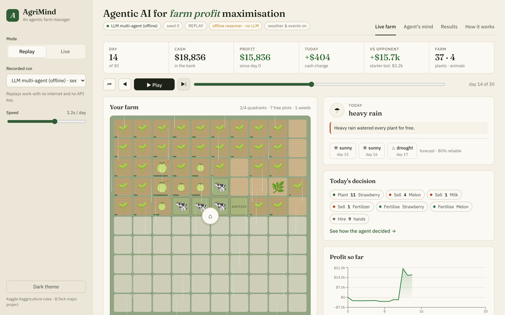
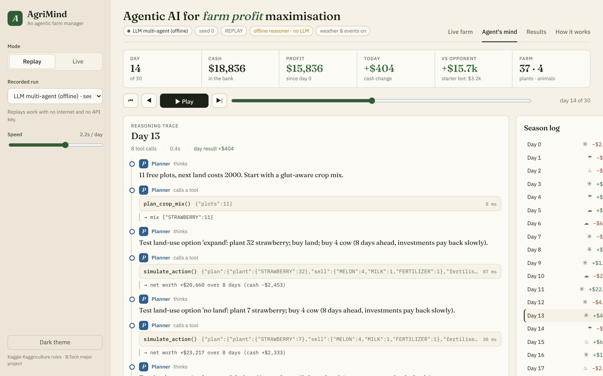
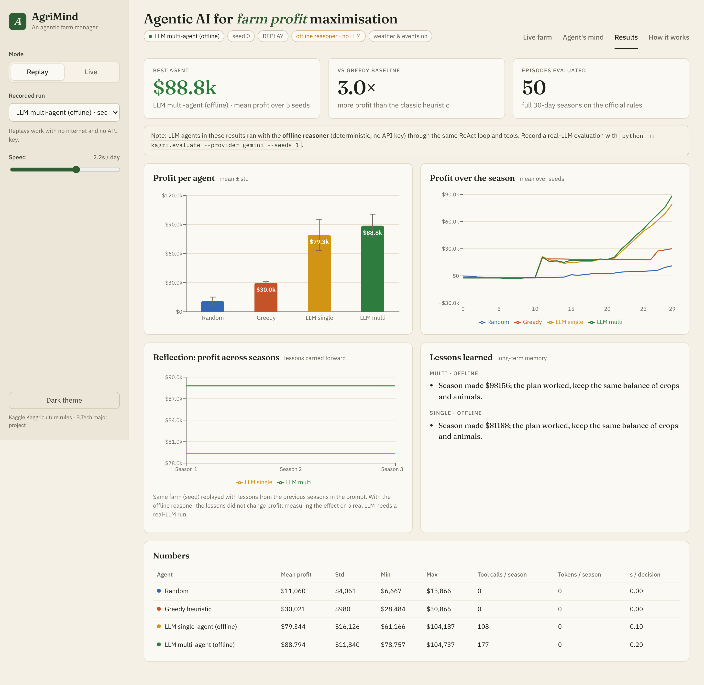

# AgriMind: agentic AI for farm profit maximisation

A final-year B.Tech (CSE) major project built on the Kaggle simulation competition
**[Kaggriculture](https://www.kaggle.com/competitions/kaggriculture)**: run a farm for a 30-day
season and end with as much money as possible.

An LLM agent manages the farm using **ReAct** (it thinks, calls tools, reads the results, then
acts), **look-ahead simulation**, **short-term and long-term memory with reflection**, and an
optional **multi-agent team** (Planner, Market Analyst, Agronomist and a Manager). It plays on the
**official competition rules engine** and is compared with Random and Greedy baselines.



| Agent's mind | Results |
|---|---|
|  |  |

## Results (5 seeds, weather and events on)

| Agent | Mean profit | Std |
|---|---|---|
| Random | $11,060 | $4,061 |
| Greedy heuristic | $30,021 | $980 |
| LLM single-agent (offline reasoner) | $79,344 | $16,126 |
| **LLM multi-agent (offline reasoner)** | **$88,794** | $11,840 |

The multi-agent manager earns about **3x the greedy baseline**. Every agent starts with $3,000; the
built-in "starter" opponent ends near $3,500.

> **Honest note.** The LLM-agent rows above were produced by the **offline reasoner**: a
> deterministic rule-based stand-in that drives the same ReAct loop, tools, memory and multi-agent
> code, but is **not a language model**. It exists so that everything runs with no API key or
> internet. To measure a real LLM, add a key and run
> `python -m kagri.evaluate --provider gemini --seeds 1`. With the offline reasoner, reflection
> produced lessons but did not change profit (flat curve in `results/reflection.png`).

Charts: `results/profit_by_agent.png`, `profit_over_time.png`, `action_distribution.png`,
`cost_latency.png`, `reflection.png`.

## Quick start on Windows

You need **Python 3.11+**. Node.js is **not** needed for the demo, because the built UI is committed.

**PowerShell**

```powershell
git clone https://github.com/Venuu07/kaggriculture-agent.git
cd kaggriculture-agent
py -3.11 -m venv .venv
.\.venv\Scripts\Activate.ps1
pip install -r requirements.txt
copy .env.example .env
```

**Git Bash**

```bash
git clone https://github.com/Venuu07/kaggriculture-agent.git
cd kaggriculture-agent
py -3.11 -m venv .venv
source .venv/Scripts/activate
pip install -r requirements.txt
cp .env.example .env
```

If PowerShell refuses to run `Activate.ps1`, run
`Set-ExecutionPolicy -Scope CurrentUser RemoteSigned` once.

Then open `.env` and paste your key (for example `GEMINI_API_KEY=...`, with `LLM_PROVIDER=gemini`).
**Without a key everything still works** on the offline reasoner.

## Commands

| What | Command |
|---|---|
| **Run the demo** (opens http://localhost:8000) | `python -m kagri.serve` |
| Evaluate every agent (about 1 min offline) | `python -m kagri.evaluate` |
| Quicker evaluation | `python -m kagri.evaluate --seeds 2 --reflection-episodes 0` |
| Competition-faithful (no weather) | `python -m kagri.evaluate --no-events` |
| Evaluate with a real LLM (slow, rate limited) | `python -m kagri.evaluate --provider gemini --seeds 1 --agents greedy,llm_single --reflection-episodes 0` |
| Record a real-LLM season for replay | `python -m kagri.record --agent llm_single --provider gemini` |
| Tests | `python -m pytest` |
| UI development (needs Node 18+) | `cd web`, `npm install`, `npm run dev` (with `python -m kagri.serve` running) |
| Rebuild the UI after changes | `cd web`, `npm run build` |

A real Gemini season is about 90-120 LLM calls (single agent) or 4-5x that (multi-agent). With
the free tier's rate limit, `LLM_MIN_INTERVAL_S=4` keeps a single-agent season at about 8-12 minutes.

## The demo

- **Replay** (default): pick a recorded run. It needs no internet and no key. Runs recorded with
  `kagri.record` appear first, marked with a dot.
- **Live**: pick an agent, provider and seed, then press Start. If the chosen provider has no
  key, the app switches to the offline reasoner and says so.
- **Tabs**: Live farm (animated grid, weather, prices, profit), Agent's mind (every thought, tool
  call and decision), Results (evaluation charts and lessons), How it works (architecture).

## How it works (short)

```
React UI ⇄ FastAPI ─► Agent (ReAct + tools + memory, optional team) ─► daily plan
          ─► guardrails (validate_plan) ─► Foreman (24 turns of moves) ─► official engine
```

- **One decision per day.** The agent decides the economics: crop mix, sales, animals,
  fertiliser, labour and land. The deterministic Foreman handles walking, watering, harvesting
  and feeding.
- **Tools:** `get_farm_state`, `get_weather_forecast`, `get_market_prices`, `estimate_crop_profit`,
  `estimate_animal_profit`, `estimate_sale`, `plan_crop_mix`, `simulate_action` (plays a plan on a copy of the farm).
- **Guardrails:** plan validation with budget and feed-reserve checks, at most 4 tool calls per
  turn, JSON retries, a safe fallback plan, and token, cost and latency counters.

Details: [docs/ARCHITECTURE.md](docs/ARCHITECTURE.md) · rules and assumptions: [docs/COMPETITION.md](docs/COMPETITION.md)

## Folder structure

```
kagri/
  engine/        official Kaggriculture rules (vendored, Apache-2.0) + standalone driver
  env.py         FarmEnv (gym-style, 1 step = 1 day), weather & events, look-ahead
  foreman.py     executes a daily plan turn by turn
  plan.py        plan schema + guardrails
  economics.py   price-curve maths
  agents/        baselines, strategy helpers, tools, prompts, memory, LLM agent (ReAct + team)
  llm/           providers (Gemini, Groq, OpenAI, Claude) + offline reasoner
  runner.py      play a season, JSONL logs     evaluate.py / charts.py   evaluation
  record.py      record a real-LLM season      server.py / serve.py      API + UI server
  config.yaml    every tunable number
web/             React + Vite + TypeScript UI (web/dist is the committed build)
runs/            recorded seasons (JSONL) for replay
results/         CSVs and PNG charts
memory/          long-term lessons written by reflection
docs/            competition notes, architecture, slides/report outlines, viva, demo script, learning guide
tests/           pytest suite
```

## Assumptions and defaults

- **Engine:** the official `kaggriculture.py` from `kaggle-environments` 1.33.3 is vendored (the full
  package pulls in jax/open_spiel/transformers, which is too heavy for a Windows laptop).
- **Opponent:** player 2 is the built-in "starter" bot sharing the market. We maximise our own
  profit (`final cash − $3,000`), which ranks agents the same way as the competition's coins.
- **Decision frequency:** 30 decisions per season (one per day) instead of 720 per-turn actions.
- **Weather and events** (drought, heavy rain, pests, price shocks) are **our extension**. They are
  on by default; use `--no-events` for pure competition rules.
- **UI stack:** React + FastAPI replaced the originally planned Streamlit app, for a better demo.
  The demo command is `python -m kagri.serve`.
- **Default LLM:** Gemini (`gemini-2.5-flash`). Model names can be changed in `.env`.
- **Costs** in the results use approximate list prices; free tiers cost $0.

## Docs for the team

[PPT outline](docs/PPT_OUTLINE.md) · [Report outline](docs/REPORT_OUTLINE.md) ·
[Viva Q&A](docs/VIVA.md) · [Demo script](docs/DEMO_SCRIPT.md) · [Learn the project](docs/LEARN.md)

## Credits

Kaggriculture environment © Kaggle (Bovard Doerschuk-Tiberi, Domino Weir, María Cruz), Apache-2.0.
