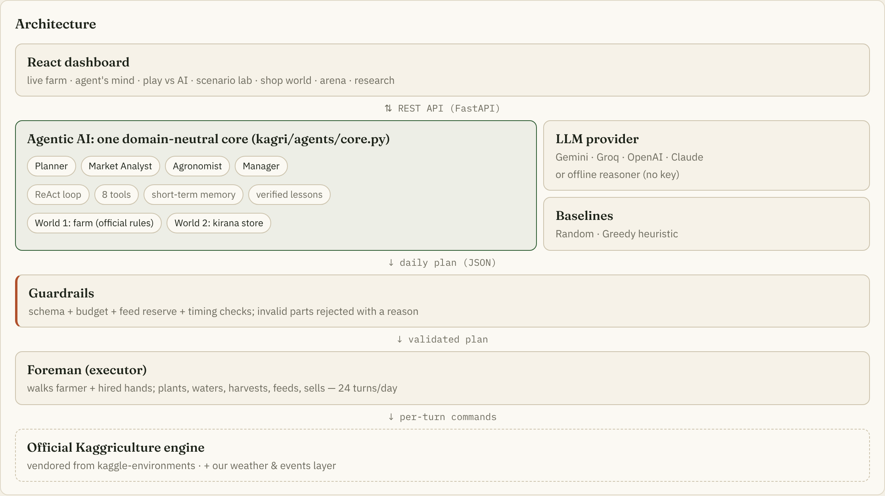
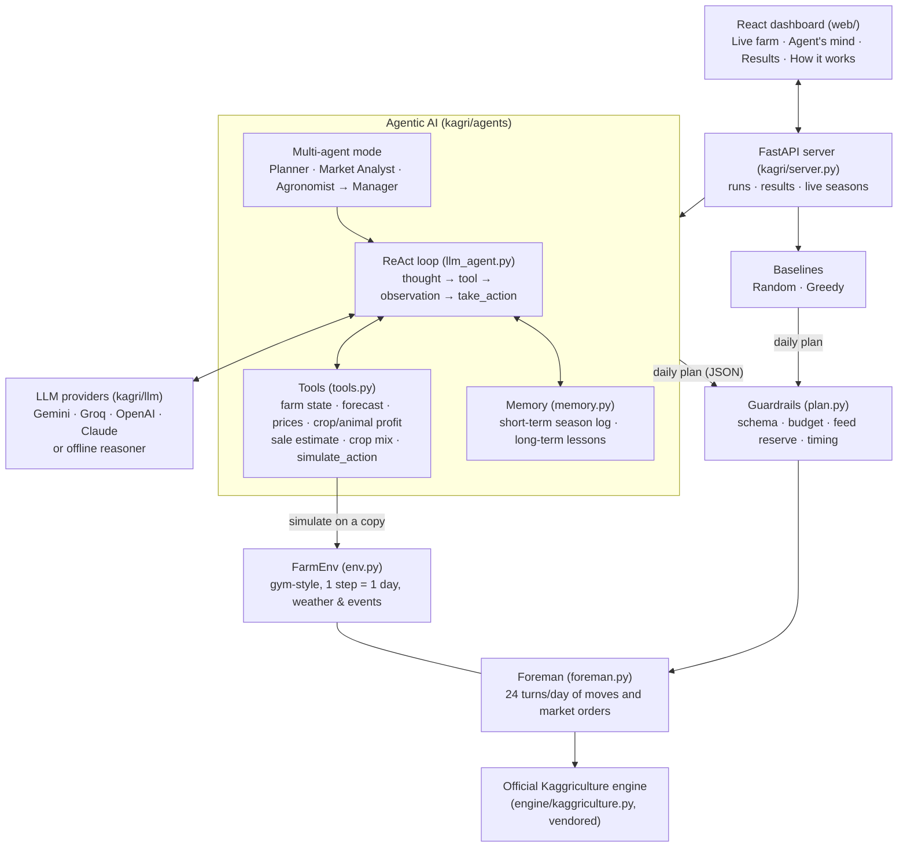

# Architecture

## Layers, bottom up

| Layer | File(s) | Job |
|---|---|---|
| Engine | `kagri/engine/kaggriculture.py`, `driver.py` | The official competition rules, plus a 60-line driver that runs them without the Kaggle framework |
| Environment | `kagri/env.py` | `FarmEnv.reset(seed)` / `step(plan)`. One step = one day. Weather and events, observation summary, `simulate()` look-ahead on a deep copy, `net_worth()` |
| Foreman | `kagri/foreman.py` | Turns a daily plan into per-turn commands for the farmer and hands: task list per tile, nearest-task assignment, fetch trips to the shed, market orders, last-day sell-off |
| Guardrails | `kagri/plan.py` | `validate_plan()` cleans any plan: unknown keys, bad numbers, too few free plots, overspending (keeps a 3-day animal-feed reserve), crops that cannot ripen before day 29. Never raises; every rejection has a reason |
| Economics | `kagri/economics.py` | Walks the official price curves: sale proceeds, glut-aware crop profit, animal payback |
| Strategy | `kagri/agents/strategy.py` | Building blocks: marginal crop mix, sell sizing, labour, animals, fertiliser. Used by the offline reasoner and as the safe fallback plan |
| Agents | `kagri/agents/` | `baselines.py` (Random, Greedy); `llm_agent.py` (ReAct, multi-agent, reflection); `tools.py`; `memory.py`; `prompts.py` |
| LLM | `kagri/llm/providers.py`, `offline.py` | One `respond(system, messages)` interface over plain HTTPS for 4 providers; the offline reasoner speaks the same JSON protocol with rules instead of a model |
| Runner / eval | `kagri/runner.py`, `evaluate.py`, `charts.py`, `record.py` | Play seasons, log every day as JSONL, aggregate CSVs, draw PNG charts, record real-LLM runs |
| Agent core | `kagri/agents/core.py` | The domain-neutral ReAct loop (`react_loop`), used by the farm and the shop |
| Second world | `kagri/shop/` | Kirana store env, shop tools, offline shopkeeper, fixed-rule baseline |
| Interactive | `kagri/play.py`, `kagri/scenarios.py` | Play vs AI (human seat on the shared market), Scenario Lab (scripted crises) |
| Research | `kagri/ablation.py`, `reflection.py`, `arena.py`, `realweather.py` | Ablation study, verified reflection, two-player Arena with Bradley-Terry ratings, real historical weather |
| Server / UI | `kagri/server.py`, `serve.py`, `web/` | FastAPI JSON API + the built React app; replay recorded runs or play live |

## One day, end to end

1. `FarmEnv.observe()` builds a compact state: cash, plots, shed, prices, weather, forecast.
2. The agent decides. For `LLMAgent` (`_react`):
   - The system prompt holds the role, game rules, plan schema, tool list, protocol and **long-term lessons**.
   - The user message holds today's state and the **short-term memory** (last 5 days).
   - The model replies `{"thought", "action", "args"}`. If the action is a tool, `ToolBox.call()` runs it and the result goes back as the next message.
   - Guardrails: at most 4 tool calls, up to 2 retries for bad JSON, then a safe fallback plan.
   - Multi-agent mode (`_team`): the Planner, Market Analyst and Agronomist each run their own ReAct loop with a restricted tool set and propose part of the plan. The Manager merges the parts, checks the result with `simulate_action` and commits.
3. `validate_plan()` trims or rejects invalid parts and records why.
4. The `Foreman` plays 24 turns. The built-in opponent plays its turns on the same market.
5. The day's record goes to JSONL: state, full trace, plan, rejections, events, sales, reward, tokens, latency.
6. After day 29, `end_episode()` asks the model to reflect on the season's evidence and stores the lessons in `memory/lessons_*.json`.

## Design decisions

- **One decision per day, not per turn.** It keeps LLM cost at about 30 decisions per season and puts the LLM where it adds value (strategy) instead of path-finding.
- **Vendor the engine instead of reimplementing it.** The rules stay exactly the competition's, and installation stays simple on Windows.
- **A JSON protocol instead of native function calling.** One loop works for every provider, including the offline reasoner.
- **Look-ahead as a tool.** `simulate_action` lets the agent test a plan on a copy of the farm. This is what lets it value investments that pay off later (melons, land, animals).
- **Offline-first demo.** Recorded runs replay with no network. A missing key switches to the offline reasoner, and the UI says so.
